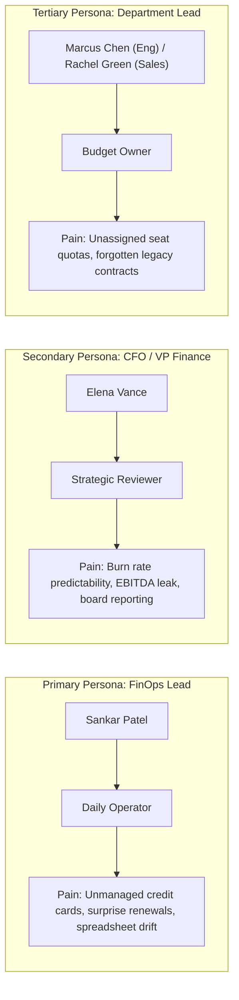
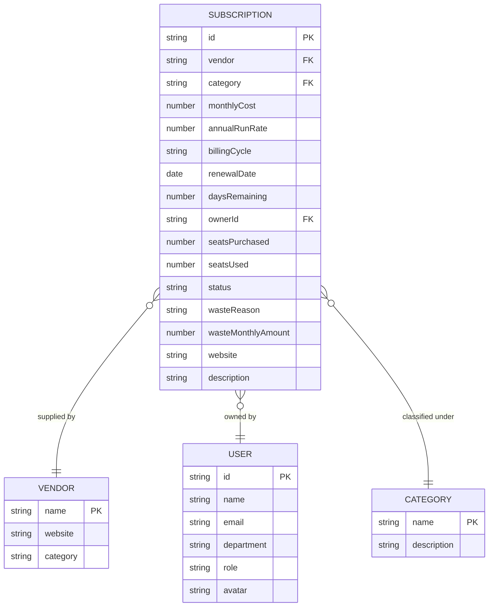
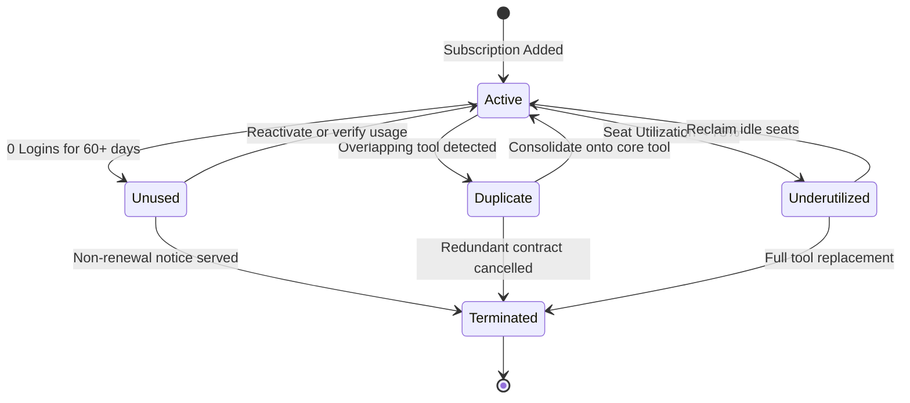
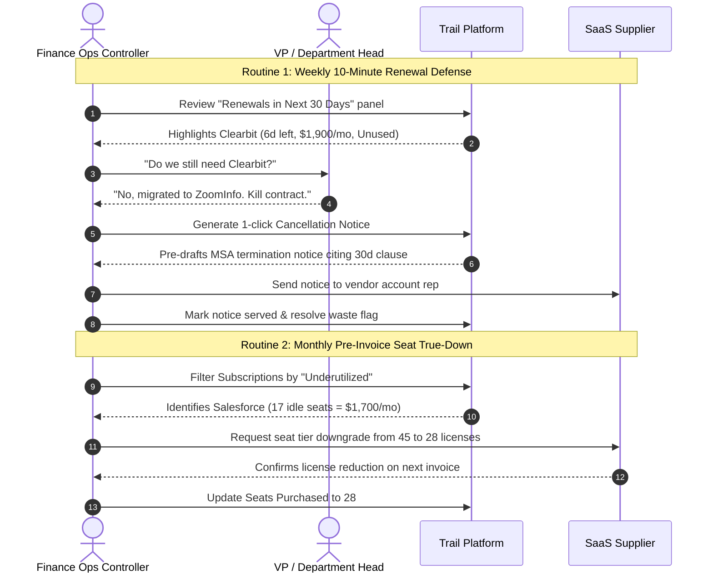

# Product Requirements Document (PRD) v2.0
# Trail — SaaS Spend & Renewal Management Platform

---

### Document Control & Metadata
| Field | Value |
|---|---|
| **Document ID** | PRD-TRAIL-2026-V2 |
| **Product Name** | **Trail** |
| **Document Version** | 2.0 (Comprehensive Redesign & Baselined) |
| **Status** | **Approved & Baselined** |
| **Target Audience** | Finance Ops, Financial Controllers, VP Finance, Fractional CFOs |
| **Target Company Profile** | 50–200 employee growth companies (Series A through Series C) |
| **Repository Path** | `C:\Users\SANKET\trail-spend-management` |
| **Live Application URL**| `http://localhost:5180/` |
| **Author / Sign-off** | Product Owner & FinOps Working Group |

---

## 1. Executive Summary & Strategic Context

### 1.1 Strategic Vision
**Trail** is an enterprise-grade SaaS spend management and contract defense operating system engineered specifically for finance operations teams at mid-market growth companies (50–200 employees).

Between 50 and 200 employees, company purchasing decentralizes rapidly. Department leads swipe corporate credit cards without coordination, leading to unmonitored software proliferation. Research across high-growth startups indicates that **18% to 25% of annual software expenditure is pure waste**:
- Abandoned subscriptions continue billing long after project conclusion.
- Siloed teams procure competing tools solving identical business needs.
- Contracted seat tiers exceed actual monthly active users by 30% or more.
- Master Service Agreements (MSAs) auto-renew unnoticed due to restrictive 30-to-60-day written cancellation notice windows.

Trail solves this by providing a unified, high-density dashboard that tracks every software subscription, quantifies monthly dollar waste in real time, and enforces an automated countdown on contract renewals.

```
┌────────────────────────────────────────────────────────────────────────┐
│                        TRAIL VALUE EQUATION                            │
├────────────────────────────────────────────────────────────────────────┤
│  Total Software Spend   : $32,365 / month   ($388,380 / year)         │
│  Identified Waste Drain :  $7,715 / month   ( $92,580 / year) [23.8%] │
│  Recoverable Margin     : +$92,580 back to EBITDA with 0 team friction │
└────────────────────────────────────────────────────────────────────────┘
```

---

## 2. User Personas & Mental Models



### Detailed Persona Matrix

| Dimension | Primary Persona: Finance Ops Controller | Secondary Persona: VP Finance / CFO | Tertiary Persona: Department Budget Owner |
|---|---|---|---|
| **Representative** | Sankar Patel (Head of Finance Ops) | CFO / Board Observer | Rachel Green (VP Sales) / Marcus Chen (VP Eng) |
| **Primary Goal** | Stop money leaving the bank account on zombie subscriptions. | Accurate 12-month forward ARR forecasting and EBITDA preservation. | Ensure team has the necessary tooling without exceeding departmental budget. |
| **Frequency of Use**| Daily / Weekly (Operational Triage). | Monthly / Quarterly (Executive Board Cadence). | Bi-weekly (Seat allocation and approval workflows). |
| **Key Metric** | Immediate dollar waste recovered; renewals flagged within 30-day notice windows. | Total SaaS ARR, Spend-as-%-of-Revenue, EBITDA impact. | Active seat utilization rate (Seats Used / Seats Purchased). |
| **Frustration** | Being blamed when an unused $25,000/yr tool auto-renews quietly. | Surprise SaaS variance on month-end general ledger close. | Bureaucratic procurement cycles and manual license tracking. |

---

## 3. The 4 SaaS Sprawl Traps: Root-Cause Failure Analysis

```mermaid
flowchart TD
    subgraph Trap1["Trap 1: Ghost Subscriptions (Unused)"]
        T1_A["Team migrates stack<br/>(e.g., Asana -> Linear)"] --> T1_B["Legacy workspace abandoned"]
        T1_B --> T1_C["Card auto-charges monthly ($880/mo)"]
        T1_C --> T1_D["100% Capital Loss"]
    end

    subgraph Trap2["Trap 2: Duplicate Stacks (Redundancy)"]
        T2_A["Design buys Miro ($720/mo)"]
        T2_B["Figma includes FigJam for free"]
        T2_A & T2_B --> T2_C["Paying 2 vendors for 1 capability"]
        T2_C --> T2_D["Redundant Multi-Vendor Fee"]
    end

    subgraph Trap3["Trap 3: Idle Seats (Underutilization)"]
        T3_A["Hiring ramp provisions 45 Salesforce seats"] --> T3_B["Headcount stalls / attrition occurs"]
        T3_B --> T3_C["Only 28 reps log in; 17 seats idle"]
        T3_C --> T3_D["$1,700/mo Unassigned Seat Drain"]
    end

    subgraph Trap4["Trap 4: Auto-Renewal Ambush"]
        T4_A["Contract has 30-day notice window"] --> T4_B["Finance alerted on day 10"]
        T4_B --> T4_C["Notice clause breached"]
        T4_C --> T4_D["Forced 12-Month Lock-In"]
    end
```



### Quantitative Trap Manifest

| Trap Category | Real-World Example in Trail | Diagnostic Trigger | Recovery Action in Trail |
|---|---|---|---|
| **1. Ghost Subscriptions** | *Clearbit ($1,900/mo)*<br>*Asana ($880/mo)*<br>*Midjourney ($240/mo)* | 0 active logins recorded for $\ge 60$ days; API key revocations. | 1-click Cancellation Notice generation; automated vendor non-renewal notification. |
| **2. Duplicate Tools** | *Miro Enterprise ($720/mo)* overlaps with *FigJam* in Figma Org.<br>*HubSpot CRM ($1,150/mo)* overlaps with *Salesforce*. | Multiple vendors classified under identical category solving the same operational function. | Consolidation playbook: migrate workspaces onto core enterprise agreement; cancel secondary tool. |
| **3. Idle Seats** | *Salesforce* (17 idle seats = $1,700/mo waste).<br>*ChatGPT Team* (25 idle seats = $625/mo waste).<br>*Greenhouse ATS* (8 idle seats = $550/mo waste). | Seat Utilization: $\frac{\text{Seats Used}}{\text{Seats Purchased}} < 75\%$. | License true-down request submitted to vendor account manager prior to next invoice. |
| **4. Auto-Renewal Ambush** | *Clearbit* (6 days left).<br>*Asana* (9 days left).<br>*Miro* (12 days left). | Days remaining $\le 14$ days before auto-renewal execution. | **Red Alert Warning Pill**; pre-drafted legal non-renewal notice enforcing 30-day MSA clause. |

---

## 4. Canonical Information Architecture & Data Model



### 4.1 Strict Canonical Categories (8 Required)
1. **`Productivity`**: Slack, Notion, Linear, Asana, Google Workspace.
2. **`AI tools`**: OpenAI (ChatGPT Team), GitHub Copilot, Midjourney, Claude Enterprise.
3. **`Infrastructure`**: AWS, Datadog, Snowflake, Vercel, Cloudflare.
4. **`Marketing`**: Clearbit, Mixpanel, Customer.io, Semrush.
5. **`Sales`**: Salesforce Sales Cloud, HubSpot CRM, Gong.io, Apollo.
6. **`Design`**: Figma Organization, Miro Enterprise, Adobe Creative Cloud.
7. **`HR`**: Rippling, Greenhouse ATS, Gusto, Deel.
8. **`Finance`**: NetSuite OneWorld ERP, Carta Total Compensation, QuickBooks.

### 4.2 Lifecycle Status State Machine



---

## 5. Mathematical Calculation Engine & Formulas

All calculations execute deterministically client-side with zero asynchronous drift:

### 5.1 Total Monthly Spend
$$\text{Total Monthly Spend} = \sum_{i=1}^{N} \text{monthlyCost}_i$$

### 5.2 Annual Run Rate (ARR)
$$\text{ARR} = \text{Total Monthly Spend} \times 12$$

### 5.3 Recoverable Monthly Waste Formula
$$\text{Total Monthly Waste} = W_{\text{unused}} + W_{\text{duplicates}} + W_{\text{underutilized}}$$

Where:
- **Unused Waste ($W_{\text{unused}}$)**:
  $$W_{\text{unused}} = \sum_{i \in \text{Unused}} \text{monthlyCost}_i$$
- **Duplicate Waste ($W_{\text{duplicates}}$)**:
  $$W_{\text{duplicates}} = \sum_{i \in \text{Duplicates}} \text{monthlyCost}_i$$
- **Underutilized Seat Waste ($W_{\text{underutilized}}$)**:
  $$W_{\text{underutilized}} = \sum_{i \in \text{Underutilized}} \left( \frac{\text{monthlyCost}_i}{\text{seatsPurchased}_i} \times (\text{seatsPurchased}_i - \text{seatsUsed}_i) \right)$$

### 5.4 Days Remaining & Urgency Calculation
$$\Delta_{\text{days}} = \left\lceil \frac{T_{\text{renewal}} - T_{\text{today}}}{86,400,000 \text{ ms}} \right\rceil$$

$$\text{Urgency Tier} = \begin{cases}
\mathbf{CRITICAL} \quad (\text{Red Badge}), & \text{if } 0 \le \Delta_{\text{days}} \le 14 \\
\mathbf{APPROACHING} \quad (\text{Slate Badge}), & \text{if } 15 \le \Delta_{\text{days}} \le 30 \\
\mathbf{SCHEDULED} \quad (\text{Muted Date}), & \text{if } \Delta_{\text{days}} > 30
\end{cases}$$

### 5.5 Currency Localization Conversion
$$\text{Display Amount} = \begin{cases}
\text{USD } (\$), & \text{Base Amount} \\
\text{INR } (₹), & \text{Base Amount} \times 83.50 \quad (\text{formatted in Lakhs/Crores})
\end{cases}$$

---

## 6. Screen-by-Screen UI & Wireframe Architecture

### 6.1 Dashboard Home Wireframe
```
┌────────────────────────────────────────────────────────────────────────────────────────────────────────┐
│ TOPNAV: Trail / Dashboard               [Global Search: Vendor, Owner...]   [USD | INR]  [+ Add Sub]   │
├────────────────────────────────────────────────────────────────────────────────────────────────────────┤
│ ALERT RIBBON: (•) Finance Ops Audit: 5 contracts renew in <14 days. $7,715/mo waste identified.         │
├────────────────────────────────────────────────────────────────────────────────────────────────────────┤
│ ┌──────────────────────┐ ┌──────────────────────┐ ┌──────────────────────┐ ┌─────────────────────────┐ │
│ │ MONTHLY SPEND        │ │ ANNUAL RUN RATE (ARR)│ │ ACTIVE CONTRACTS     │ │ ESTIMATED MONTHLY WASTE │ │
│ │ $32,365/mo           │ │ $388,380/yr          │ │ 14 / 20 active       │ │ $7,715/mo (23.8%) [RED] │ │
│ │ Across 20 tools      │ │ 12-month forward     │ │ 6 flagged for review │ │ $92,580/yr leak         │ │
│ └──────────────────────┘ └──────────────────────┘ └──────────────────────┘ └─────────────────────────┘ │
├────────────────────────────────────────────────────────────────┬───────────────────────────────────────┤
│ RENEWALS IN NEXT 30 DAYS (Filter: [All 30d (11)] | [Urgent (5)])│ SPEND BY CATEGORY                     │
├────────────────────────────────────────────────────────────────┼───────────────────────────────────────┤
│ • Clearbit Enrichment    Marketing   $1,900/mo  [6d LEFT - RED]│ Infrastructure  $11,350/mo   (35.1%)  │
│ • Asana Business         Productiv.    $880/mo  [9d LEFT - RED]│ Sales            $7,100/mo   (21.9%)  │
│ • ChatGPT Team           AI tools    $1,500/mo [11d LEFT - RED]│ Productivity     $5,140/mo   (15.9%)  │
│ • Miro Enterprise        Design        $720/mo [12d LEFT - RED]│ Finance          $3,650/mo   (11.3%)  │
│ • Midjourney Pro         AI tools      $240/mo [14d LEFT - RED]│ AI tools         $2,720/mo   ( 8.4%)  │
│ • GitHub Copilot         AI tools      $980/mo [17d left]      │ HR               $2,350/mo   ( 7.3%)  │
├────────────────────────────────────────────────────────────────┴───────────────────────────────────────┤
│ SOFTWARE WASTE BREAKDOWN (Recoverable: $7,715/mo)                                                      │
├────────────────────────────────────────────────────────────────────────────────────────────────────────┤
│ [████████████████████████ Red: Unused $2,970 ][██████████ Purple: Dups $1,870 ][████████████ Amber]  │
│ ┌────────────────────────────┐ ┌────────────────────────────┐ ┌──────────────────────────────────────┐ │
│ │ Unused Tools: $2,970/mo    │ │ Duplicate Stacks: $1,870/mo│ │ Idle Seats: $2,875/mo                │ │
│ │ 3 tools with 0 logins      │ │ 2 overlapping software     │ │ 50 unassigned seat licenses          │ │
│ └────────────────────────────┘ └────────────────────────────┘ └──────────────────────────────────────┘ │
└────────────────────────────────────────────────────────────────────────────────────────────────────────┘
```

### 6.2 Subscriptions Table Wireframe
```
┌────────────────────────────────────────────────────────────────────────────────────────────────────────┐
│ FILTER BAR: Category: [All Categories ▾]   Status: [All Statuses ▾]   Search: [__________]  [Reset]    │
├───────────────────┬──────────────┬──────────────┬────────────┬─────────────┬───────────┬───────┬───┤
│ VENDOR & TOOL     │ CATEGORY     │ OWNER        │ MONTHLY    │ SEATS USED  │ RENEWAL   │ STATUS│   │
├───────────────────┼──────────────┼──────────────┼────────────┼─────────────┼───────────┼───────┼───┤
│ [AW] AWS          │ Infrastruct. │ Alex Rivera  │ $5,200/mo  │ 38/40 [███] │ in 18d    │ Active│ › │
│ [SF] Salesforce   │ Sales        │ Rachel Green │ $4,500/mo  │ 28/45 [██░] │ in 24d    │ Idle  │ › │
│ [CB] Clearbit     │ Marketing    │ Jessica Wu   │ $1,900/mo  │  0/15 [░░░] │ 6d [RED]  │ Unused│ › │
│ [AS] Asana        │ Productivity │ David Kim    │   $880/mo  │  2/35 [░░░] │ 9d [RED]  │ Unused│ › │
│ [MR] Miro         │ Design       │ Tom Miller   │   $720/mo  │ 14/40 [██░] │ 12d [RED] │ Dupl. │ › │
│ [CG] ChatGPT Team │ AI tools     │ Marcus Chen  │ $1,500/mo  │ 35/60 [██░] │ 11d [RED] │ Idle  │ › │
│ [SL] Slack Grid   │ Productivity │ Elena Rostova│ $2,100/mo  │142/150[███] │ in 142d   │ Active│ › │
└───────────────────┴──────────────┴──────────────┴────────────┴─────────────┴───────────┴───────┴───┘
```

### 6.3 Slide-Out Subscription Detail Drawer Wireframe
```
┌──────────────────────────────────────────────────────────────────────┐
│ [✕ CLOSE]  [SL] Salesforce Sales Cloud       [Underutilized Badge]   │
│ https://salesforce.com                                               │
├──────────────────────────────────────────────────────────────────────┤
│ ⚠ WASTE FLAG DIAGNOSIS                                               │
│ 17 unassigned Enterprise licenses ($100/seat/mo). Only 28 reps log in│
│ Monthly Capital Leak: +$1,700/mo ($20,400/yr)                        │
│ [✓ Mark Waste Resolved]                                              │
├──────────────────────────────────────────────────────────────────────┤
│ FINANCIAL & CONTRACT TERMS                                           │
│ Monthly Spend: $4,500/mo          Annual ARR: $54,000/yr             │
│ Billing Cycle: Annual             Department: Sales                  │
├──────────────────────────────────────────────────────────────────────┤
│ RENEWAL TIMELINE                                                     │
│ Renewal Date: 2026-10-23          Days Remaining: 24 days            │
│ Notice Policy: Standard 30-day non-renewal clause                    │
├──────────────────────────────────────────────────────────────────────┤
│ SEAT UTILIZATION MATRIX                                              │
│ Active Seats: 28 / 45 provisioned (62% utilized)                     │
│ [████████████████████░░░░░░░░░░]                                     │
│ Idle Seats to Reclaim: 17 licenses                                   │
├──────────────────────────────────────────────────────────────────────┤
│ RESPONSIBLE BUDGET OWNER                                             │
│ [RG] Rachel Green — VP of Sales (Sales Department)                   │
│ rachel.g@acme.corp                                                   │
├──────────────────────────────────────────────────────────────────────┤
│ STATUS OVERRIDE: [Active]  [Unused]  [Duplicate]  [Underutilized]    │
├──────────────────────────────────────────────────────────────────────┤
│ [🗑 Remove Record]                                    [Close Details] │
└──────────────────────────────────────────────────────────────────────┘
```

---

## 7. Ways of Usage: The 3 Operational SOPs



### Detailed SOP Specifications

#### SOP-1: Weekly 10-Minute Auto-Renewal Defense
- **Frequency**: Every Monday morning, 9:00 AM.
- **Duration**: 10 minutes.
- **Operator**: Finance Ops Controller / Accountant.
- **Execution Steps**:
  1. Open Trail Dashboard Home.
  2. Inspect the **Renewals in Next 30 Days** panel, toggling to `Urgent (<14d)`.
  3. For any contract marked `Unused` or `Duplicate`:
     - Click **Review & Act**.
     - Open the pre-formatted Cancellation Notice Generator.
     - Copy the notice and email the vendor account executive.
     - Mark "Notice Sent & Logged" in Trail.
- **Target Outcome**: 0 surprise auto-renewals; 100% compliance with vendor termination clauses.

#### SOP-2: Monthly Seat True-Down & License Reclamation
- **Frequency**: 5 days prior to month-end close.
- **Duration**: 20 minutes.
- **Operator**: Finance Controller + Department Leads.
- **Execution Steps**:
  1. Navigate to the **Subscriptions Table**.
  2. Filter by status: `Underutilized`.
  3. Sort by `Seats (Used/Total)` ascending.
  4. Cross-reference unassigned seats with department leads (Salesforce: 17 seats, ChatGPT: 25 seats, Greenhouse: 8 seats).
  5. Issue license de-provisioning ticket to vendor billing support.
  6. Reclaim seat fees before the next billing invoice generates.
- **Target Outcome**: Immediate monthly savings of **$2,875/mo ($34,500/yr)**.

#### SOP-3: Quarterly Software Stack Consolidation
- **Frequency**: End of Fiscal Quarter (Q1, Q2, Q3, Q4).
- **Duration**: 45 minutes.
- **Operator**: VP of Finance + CTO + CMO.
- **Execution Steps**:
  1. Navigate to **Waste & Sprawl Audit** screen.
  2. Review the **Duplicate Tools** table.
  3. Audit duplicate whiteboard solutions (Miro vs FigJam) and duplicate CRMs (HubSpot vs Salesforce).
  4. Enforce migration onto the enterprise contract.
  5. Eliminate redundant supplier agreements.
- **Target Outcome**: Eliminate $1,870/mo ($22,440/yr) in duplicate subscriptions.

---

## 8. Methods of Usage

Trail accommodates four distinct operational modes:

| Method | Operating Mode | User Interaction Pattern | Output |
|---|---|---|---|
| **Method 1: Passive Defense** | Continuous Monitoring | Ambient dashboard kept open on financial operations screen. Real-time visual alerts trigger as renewal dates advance into the red window. | Prevents missed 30-day cancellation deadlines. |
| **Method 2: Multi-Currency Presenter** | Board & Global Ops | TopNav currency toggle (`USD $` vs `INR ₹`). Dynamically reformats all figures using standard regional separators (Lakhs/Crores) and monospace tabular numerals. | Seamless presentation for US and Indian leadership. |
| **Method 3: General Ledger Sync** | Financial Close | 1-click `Export CSV` from Dashboard Home. Exports RFC-4180 compliant ledger with vendor, category, owner, monthly cost, ARR, and waste status. | Direct upload into NetSuite, QuickBooks, Excel, or Google Sheets. |
| **Method 4: Granular Drawer Auditor** | Tactical Intervention | Clicking any table row opens the slide-out inspection drawer. Allows immediate status reassignment, seat true-downs, and audit notes. | Immediate state reactivity without leaving the dashboard. |

---

## 9. Design System: The Linear × Mercury Specification

```
┌────────────────────────────────────────────────────────┐
│  Linear × Mercury Design Tokens                        │
├────────────────────────────────────────────────────────┤
│  Canvas Background      : #F8F9FA (Crisp Off-White)   │
│  Cards & Surface        : #FFFFFF (Pure White)        │
│  Border Style           : 1px solid #E2E8F0           │
│  Border Radius          : 3px - 6px (Crisp Geometry)  │
│  Primary Typography     : Inter (400, 500, 600)       │
│  Numeric / Financial    : JetBrains Mono tabular-nums  │
│  Primary Accent         : #0F172A (Deep Obsidian Slate)│
│  Reserved Danger Color  : #EF4444 (Strictly Waste/14d) │
│  Caution Color          : #F59E0B (Underutilization)   │
│  Healthy Color          : #10B981 (Emerald Active)     │
└────────────────────────────────────────────────────────┘
```

### Strict Design System Rules
1. **Monospace Tabular Numerals**: Every monetary value, percentage, seat count, and date MUST use `font-mono tabular-nums` to guarantee vertical column alignment across rows.
2. **Reserved Red**: Red is strictly forbidden for generic badges, non-urgent icons, or aesthetic styling. Red is exclusively reserved for:
   - Identified waste dollar amounts.
   - Contracts renewing in $\le 14$ days.
   - Destructive deletion actions.
3. **No Rounded-Pills**: Generic elements use crisp 3px–4px corners (`rounded-[3px]`), avoiding bubbly rounded-full aesthetics. It must look and feel like an institutional tool trusted by a CFO.

---

## 10. Technical Stack & Implementation Map

### 10.1 Architecture
- **Framework**: React 19 + Vite 7
- **Styling**: Tailwind CSS v4 + `@tailwindcss/vite`
- **Icons**: `lucide-react`
- **State Engine**: React Context (`SpendContext`) with memoized calculation graph
- **Port**: `5180` (Preserving port `5174` for detailing website)

### 10.2 Component Map
```
C:\Users\SANKET\trail-spend-management/
├── index.html                           # App entry with Inter & JetBrains Mono preloads
├── vite.config.js                       # Vite 7 + React + Tailwind v4 on port 5180
├── package.json                         # Pure dependency manifest
├── src/
│   ├── main.jsx                         # React root mount
│   ├── App.jsx                          # Main view orchestration & auth gate
│   ├── index.css                        # Tailwind v4 directives & tabular num tokens
│   ├── data/
│   │   └── mockData.js                  # 20 subscriptions, 8 categories, 9 users
│   ├── context/
│   │   └── SpendContext.jsx             # Metrics formulas, currency, CRUD actions
│   ├── components/
│   │   ├── layout/
│   │   │   ├── Sidebar.jsx              # Obsidian dark navigation & live waste pill
│   │   │   └── TopNav.jsx               # Currency switcher ($/₹), search, Add modal
│   │   ├── dashboard/
│   │   │   ├── DashboardHome.jsx        # Top alert ribbon, KPI grid, panel integration
│   │   │   ├── KpiCards.jsx             # 4 core financial metrics
│   │   │   ├── RenewalsPanel.jsx        # 30-day renewal countdown & <14d red badges
│   │   │   ├── WasteBreakdownPanel.jsx  # Segmented bar chart & remediation triggers
│   │   │   └── CategorySpendChart.jsx   # 8-category spend distribution bars
│   │   ├── subscriptions/
│   │   │   ├── SubscriptionsTable.jsx   # Dense financial ledger with filters & sort
│   │   │   └── SubscriptionDetailDrawer.jsx # Slide-out contract inspection panel
│   │   ├── modals/
│   │   │   ├── AddSubscriptionModal.jsx # Form with auto waste derivation
│   │   │   ├── CancellationNoticeModal.jsx # 1-click legal termination notice
│   │   │   └── FinOpsPlaybookModal.jsx  # Interactive SOP checklist modal
│   │   ├── auth/
│   │   │   └── AuthScreen.jsx           # Clean auth with 1-click evaluation access
│   │   ├── common/
│   │   │   └── StatusBadge.jsx          # Semantic 3px badges
│   │   └── views/
│   │       ├── WasteView.jsx            # Executive waste audit & savings playbook
│   │       ├── RenewalsView.jsx         # 12-month contract defense calendar
│   │       ├── VendorsView.jsx          # Vendor supplier ledger
│   │       └── TeamView.jsx             # Department budget accountability map
```

---

## 11. Acceptance & Sign-off Checklist

- [x] **Target Audience**: Built for Finance Ops at 50–200 person companies.
- [x] **8 Canonical Categories**: Productivity, AI tools, Infrastructure, Marketing, Sales, Design, HR, Finance.
- [x] **Core Data Model**: Vendor, category, monthly cost, cycle, renewal date, owner, seats purchased, seats used, status.
- [x] **Top Row KPI Cards**: Monthly spend, ARR, active subscriptions, estimated waste ($ and ₹).
- [x] **Renewals in Next 30 Days Panel**: Real-time countdown with red badges for contracts $\le 14$ days.
- [x] **Waste Breakdown Panel & Stacked Chart**: Segmented distribution across Unused, Duplicate, and Idle Seats with 1-click actions.
- [x] **Subscriptions Table Screen**: Dense table, search, category & status filters, seat utilization micro-bars.
- [x] **Add Subscription Modal**: Validated form with automatic waste calculation.
- [x] **Auth Screen**: Email/password authentication plus 1-click CFO evaluation access.
- [x] **Visual Design**: Linear meets Mercury, tabular monospace numerals, reserved red for waste, sharp geometry.
- [x] **Standard Operating Procedures (SOPs)**: Weekly, Monthly, and Quarterly playbooks integrated with notice generators.
